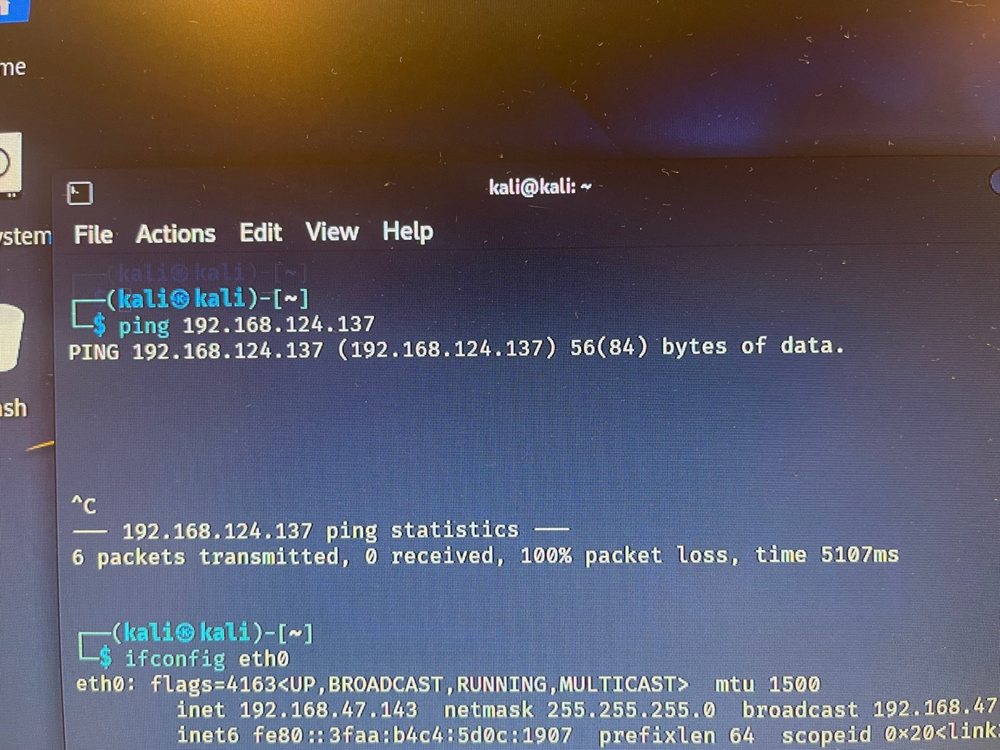
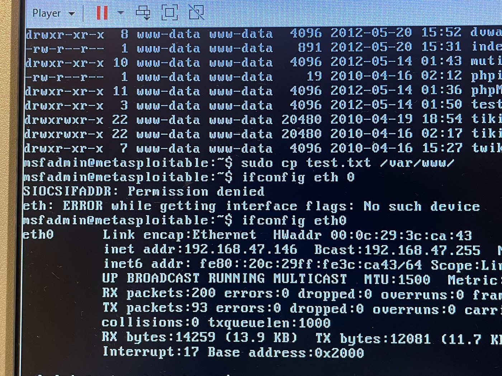
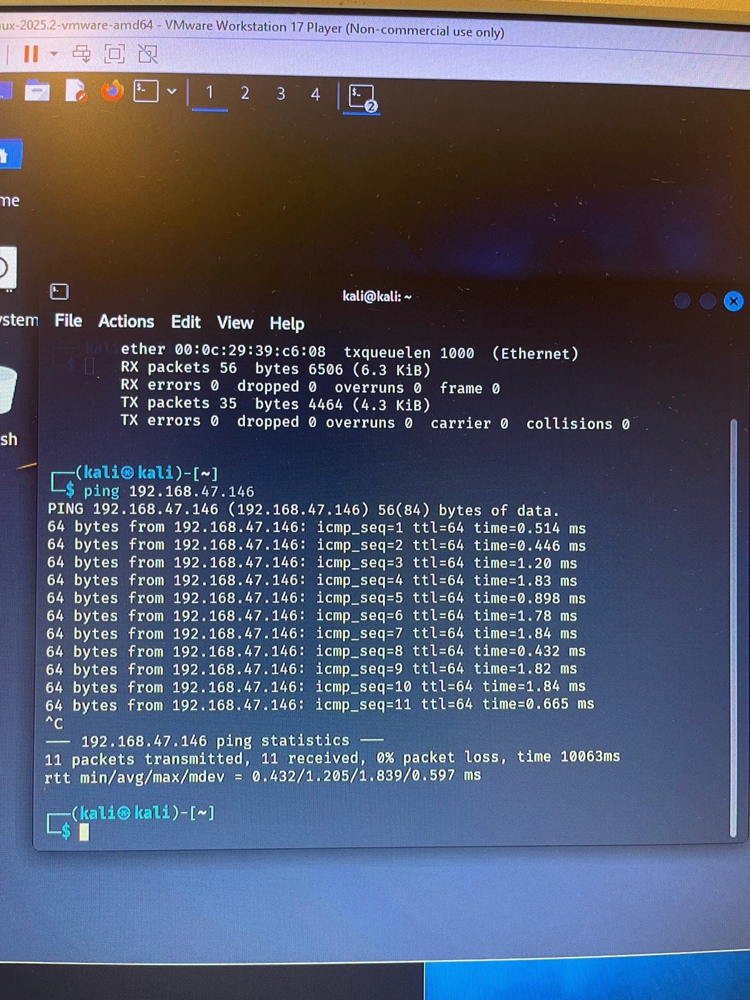
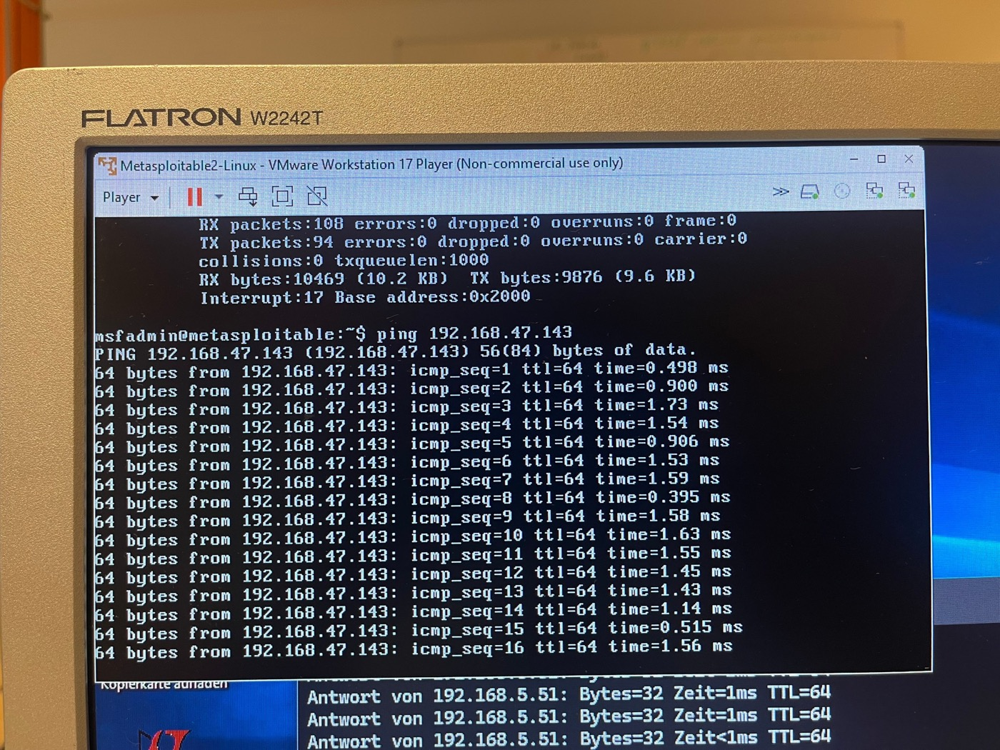
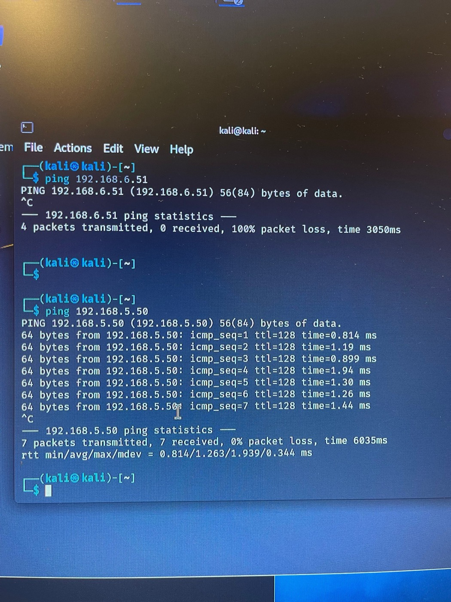
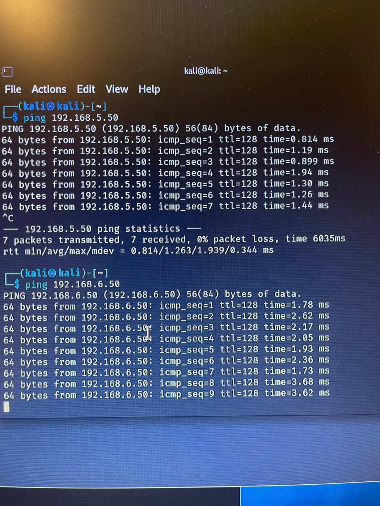
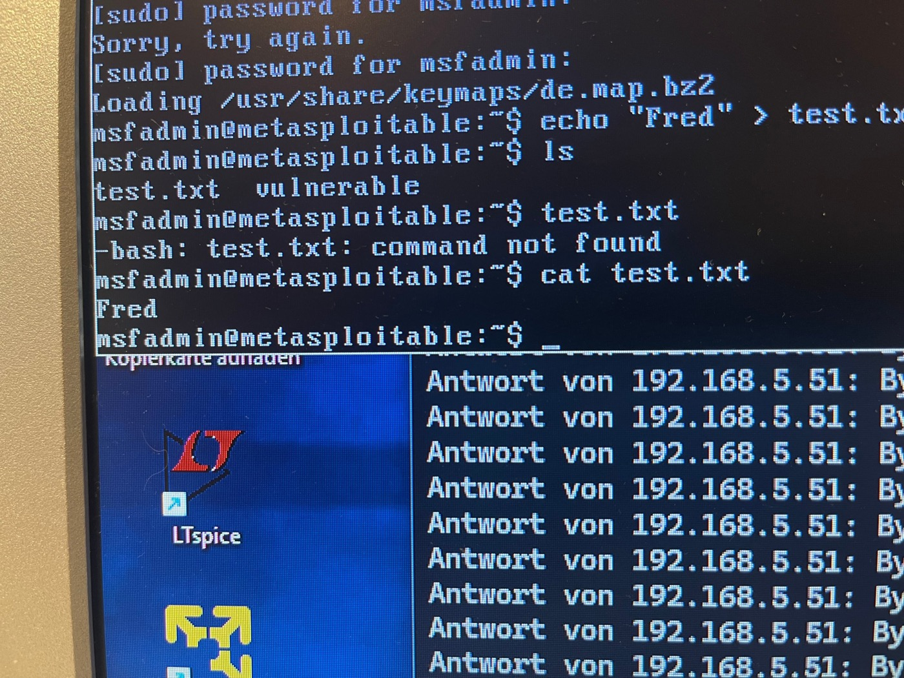
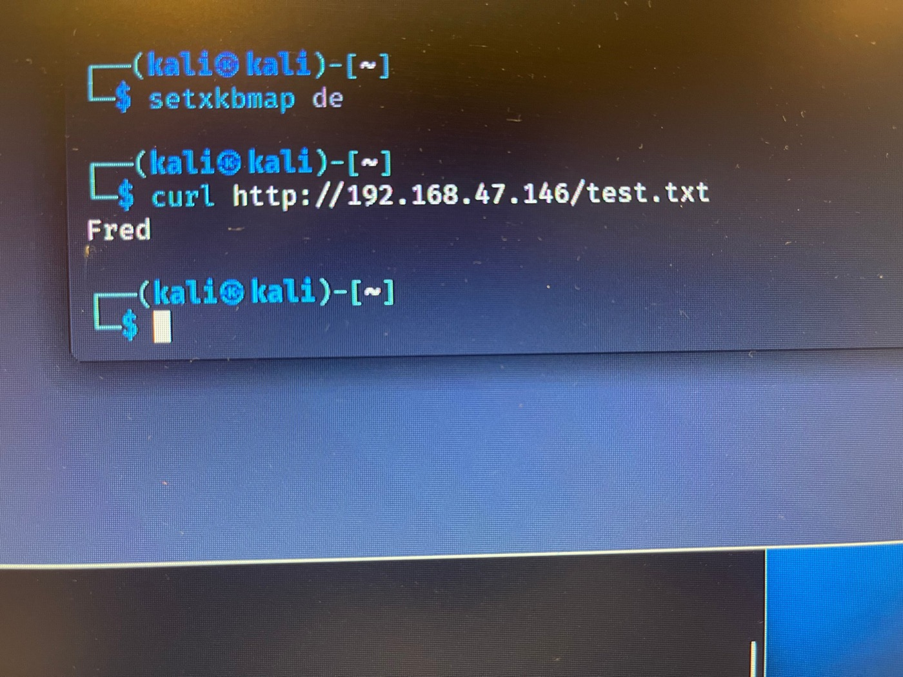

# Arbeitsbericht 05 – Networking zwischen Kali und Metasploitable

| | |
|---|---|
| **Name** | Tobias Strobl |
| **Klasse** | 3AHITS |
| **Gruppe** | 2 |
| **Datum** | 03.11.2026 |
| **Nummer** | 05 |
| **Aufgabenstellung** | https://www.franzmatejka.at/htl/doc/ITSI_3/itsi3-lab/02_network.html |

---

## 1. NAT und Bridged

Wir haben getestet, ob sich Kali und Metasploitable im NAT- und im Bridged-Modus anpingen können.

### 1.1 NAT

| Gerät | IP-Adresse | MAC-Adresse |
|---|---|---|
| Kali | 192.168.47.143 /24 | 00:0c:29:39:c6:08 |
| Metasploitable | 192.168.47.146 /24 | 00:0c:29:3c:ca:43 |

- Kein Standard-Gateway eingetragen

IP-Adressen mit `ifconfig eth0` ausgelesen:



*Kali hat 192.168.47.143. Der Ping auf 192.168.124.137 geht nicht.*



*Metasploitable hat 192.168.47.146.*

**Ping Kali → Metasploitable**

```
$ ping 192.168.47.146
```



*Alle Pings kommen zurück.*

**Ping Metasploitable → Kali**

```
$ ping 192.168.47.143
```



*Alle Pings kommen zurück.*

### 1.2 Bridged

**Ping Kali → Nachbar-PC**



*Ping auf 192.168.6.51 geht nicht. Ping auf den Nachbar-PC 192.168.5.50 geht.*



*Der Nachbar-PC antwortet auf 192.168.5.50 und auf 192.168.6.50.*

Im Hintergrund von Bild 02 und 05 sieht man einen Ping vom Windows-PC auf 192.168.5.51. Der funktioniert.

### 1.3 Unterschied NAT und Bridged

- **Bridged:** Die VM ist im gleichen Netz wie der Host und hat eine eigene IP. Andere Geräte im Netz können sie erreichen.
- **NAT:** Die VM ist in einem eigenen VMware-Netz (VMnet8). Sie kommt nach außen, aber von außen kommt man nicht zu ihr.

---

## 2. Tastatur auf Deutsch stellen

```
# Kali
$ setxkbmap de

# Metasploitable
$ sudo loadkeys de
```

---

## 3. Datei von Metasploitable zu Kali

### 3.1 Webserver finden

```
$ ps ax
$ sudo netstat -tlpn | grep apache
```

- Webserver: Apache2
- Port: 80
- Ordner: /var/www/

### 3.2 Datei anlegen

```
$ echo "Fred" > test.txt
$ cat test.txt
```



*Die Datei test.txt mit „Fred“ ist da.*

Datei in den Webserver-Ordner kopieren:

```
$ sudo cp test.txt /var/www/
```


### 3.3 Datei auf Kali holen

```
$ curl http://192.168.47.146/test.txt
```



*Kali bekommt „Fred“ zurück. Hat funktioniert.*

---

## 4. Fazit

- Im NAT-Netz können sich Kali und Metasploitable anpingen.
- Im Bridged-Netz kann Kali den Nachbar-PC anpingen.
- Mit dem Apache2-Webserver auf Metasploitable und `curl` kann man Dateien zu Kali übertragen.
