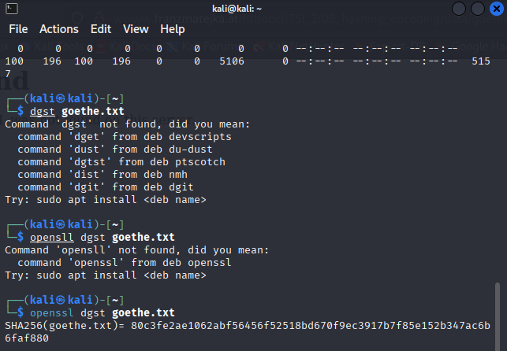
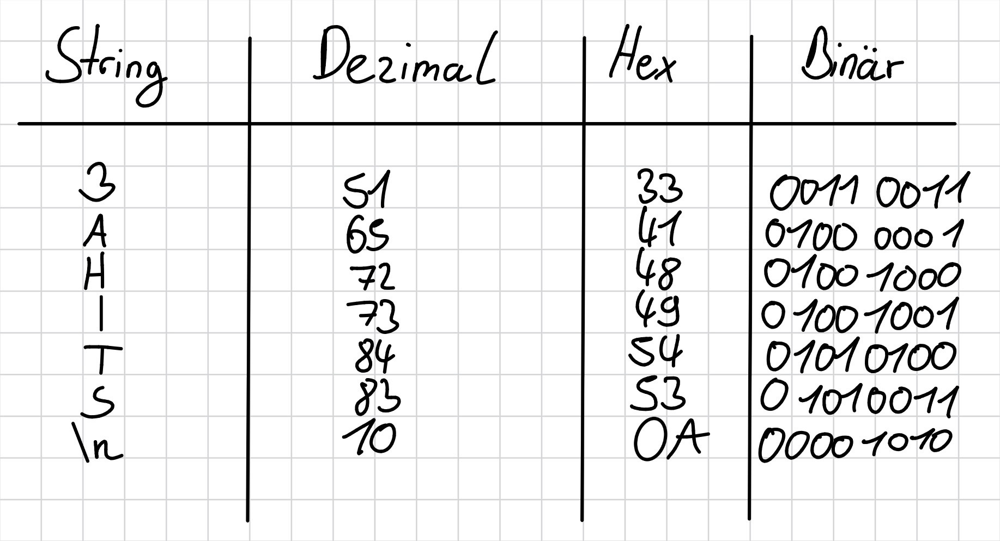
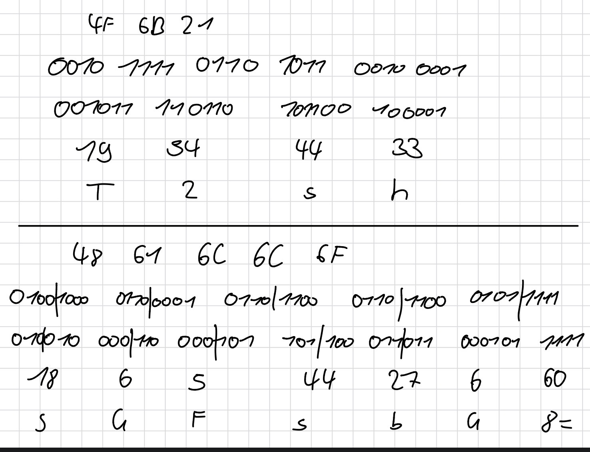

# Arbeitsbericht 03 – Hashing und Encoding

| | |
|---|---|
| **Name** | Tobias Strobl |
| **Klasse** | 3AHITS |
| **Gruppe** | 2 |
| **Datum** | 21.11.2026 |
| **Nummer** | 03 |
| **Aufgabenstellung** | https://www.franzmatejka.at/htl/doc/ITSI_3/itsi3-lab/03_hashing_encoding.html |

---

## 1. Hashfunktionen

### 1.1 Online Hash Rechner (SHA-512)

Der Text von `goethe.txt` wurde im Online-Rechner (emn178.github.io) mit SHA-512 gehasht:

```
24e59661460f325f2241564e195d88dc86d8c2bdfae825791b490d97409623f9
06b5a7ce6425f0bcd644b10481466f854e29cd76e085c112c2e169b9ad6960a6
```

Danach wurde ein einzelnes Zeichen im Text geändert → der Hash war komplett anders.

### 1.2 SHA256 mit der Shell

Datei auf Kali herunterladen und Hash berechnen:

```
$ curl -O https://www.franzmatejka.at/htl/doc/ITSI_2/05_hashing_encoding/data/goethe.txt
$ openssl dgst goethe.txt
```



*`openssl dgst` gibt den SHA256-Hash von goethe.txt aus.*

```
SHA256(goethe.txt)= 80c3fe2ae1062abf56456f52518bd670f9ec3917b7f85e152b347ac6b6faf880
```

### 1.3 SHA256 mit CyberChef

Inhalt von `goethe.txt` in CyberChef eingefügt, Operation **SHA2** (Size 256):

```
9f5e8fcf66bfbb0520295d4f6d8f674347ada8d090772563407ceedb5d567b66
```

---

## 2. Encoding

### 2.1 Radix-16 (Hex) kodieren

`3AHITS` mit Zeilenumbruch in Hex umgewandelt.



*Ergebnis: `33 41 48 49 54 53 0A`. Kontrolle in CyberChef mit **To Hex** – stimmt.*

### 2.2 Base64 kodieren

`4F 6B 21` und `48 61 6C 6C 6F` in Base64 umgewandelt.



*Ergebnis: `T2sh` und `SGFsbG8=`. Kontrolle in CyberChef mit **From Hex** → **To Base64** – stimmt.*

### 2.3 SHA256 mit CyberChef – Hex und Base64

SHA-256 von `goethe.txt` in CyberChef:

- Hex: **SHA2** (256)
- Base64: **SHA2** (256) → **From Hex** → **To Base64**

```
Hex:    9f5e8fcf66bfbb0520295d4f6d8f674347ada8d090772563407ceedb5d567b66
Base64: n16Pz2a/uwUgKV1PbY9nQ0etqNCQdyVjQHzu211We2Y=
```

---


## 3. Nicht gemacht

- **Übung (SHA256 mit Shell-Tools):** Hex-String mit `cut` bzw. `xxd`, Base64 mit `openssl`/`base64` und Länge mit `wc` wurden nicht gemacht.

---

*Hinweis: Bei der Markdown-Formatierung (z. B. Tabellen und Überschriften) hat mir KI geholfen, damit der Bericht übersichtlicher aussieht. Der Inhalt ist selbstverständlich von mir.*
